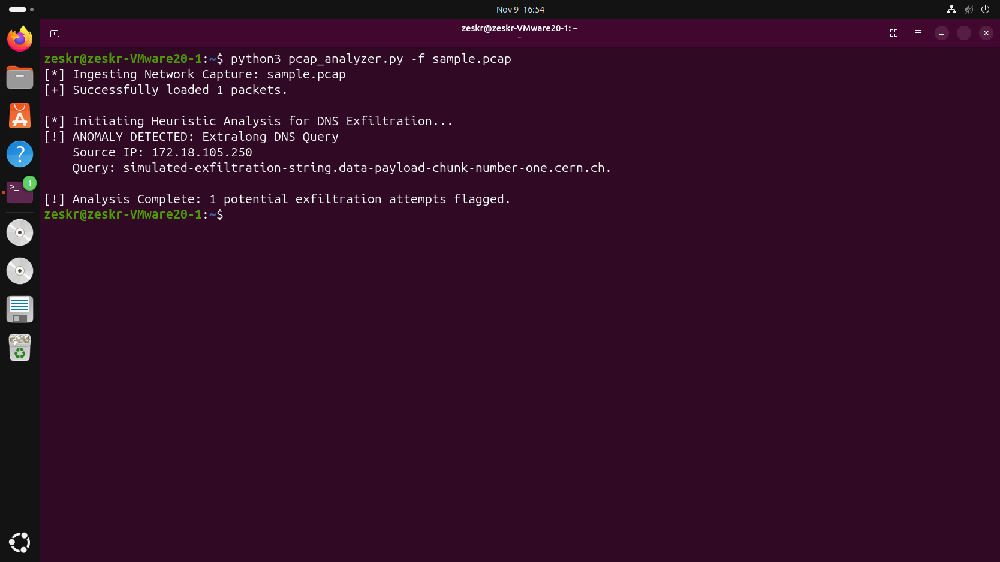

# 📡 PCAP Network Traffic Anomaly Analyzer

## Overview
A DevSecOps-integrated Python utility utilizing the `scapy` library to ingest and analyze raw packet capture (`.pcap`) files. Designed to detect Layer 7 data exfiltration techniques, this tool parses Domain Name System (DNS) Question Records to flag extralong, obfuscated queries indicative of DNS tunneling malware bypassing standard firewall rules.

## Technical Skills Applied
* **Deep Packet Inspection (DPI):** Manipulating raw network traffic via Python `scapy` to analyze Layer 3 (IP) and Layer 7 (DNS) headers.
* **Threat Hunting Heuristics:** Identifying protocol abuse by programmatically establishing baseline packet length thresholds and scanning for outliers.
* **Containerization:** Architecting a `Dockerfile` that injects `libpcap-dev` system dependencies into a lightweight Python image to ensure reliable binary packet parsing across any host environment.
* **DevSecOps (CI/CD):** Enforcing automated Static Application Security Testing (SAST) via **Bandit** and container OS vulnerability scanning via **Trivy** on every GitHub push.

## Installation & Usage

### Option A: Run via Docker (Enterprise Deployment)
```bash
# Build the Docker image
docker build -t pcap-analyzer .

# Execute against a local PCAP file (mounting the current directory to the container)
docker run --rm -v $(pwd):/app pcap-analyzer -f sample.pcap
```

### Option B: Local Execution
**Prerequisites:** Python 3.x, `scapy`, and host-level `libpcap` binaries.
```bash
git clone [https://github.com/Zeskr/PCAP-Traffic-Analyzer.git](https://github.com/Zeskr/PCAP-Traffic-Analyzer.git)
cd PCAP-Traffic-Analyzer
python3 pcap_analyzer.py -f sample.pcap
```

---

## Technical Execution & Proof of Concept
To validate the heuristic engine, a simulated DNS exfiltration payload (`nslookup this-is-a-simulated-dns-exfiltration-payload-string-to-trigger-the-alert.cern.ch`) was executed during an active `tcpdump` capture. The Python analyzer successfully ingested the resulting PCAP, parsed the UDP datagrams, and flagged the anomalous string length bypassing standard routing.


